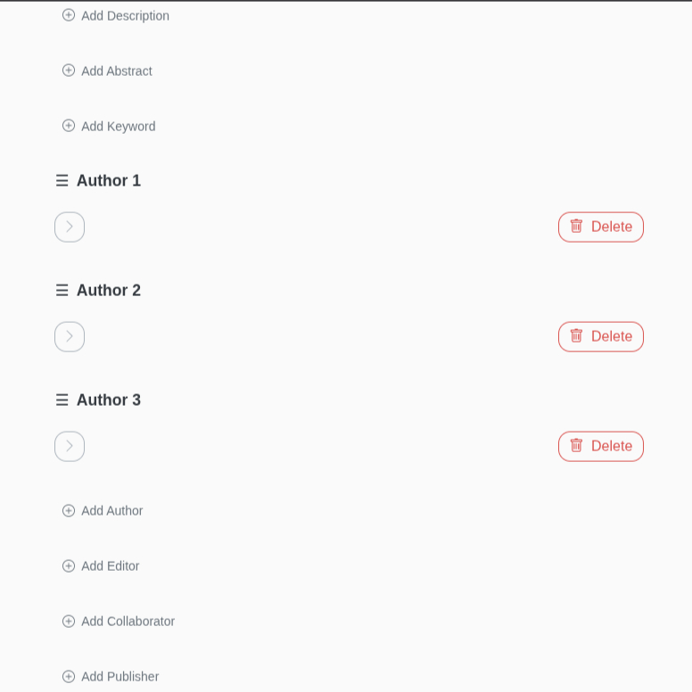

import { Aside, Code, Tabs, TabItem } from '@astrojs/starlight/components';

Unfortunately, SHACL ([SHACL Core](https://w3c.github.io/data-shapes/shacl12-core/), including its extended features for [SPARQL](https://w3c.github.io/data-shapes/shacl12-sparql/) and [node expressions](https://w3c.github.io/data-shapes/shacl12-node-expr/), and [SHACL UI](https://w3c.github.io/data-shapes/shacl12-ui/)) cannot express every aspect of the editor that we consider important. Some of the aspects it leaves out are configured in the YAML file described here: how values are ordered and how the catalogue sorts entities.

## File location

HERITRACE reads the YAML file from `display_rules.yaml` in the [configuration folder](../app-settings/#configuration-folder). To use your own file, put it in that folder with this name. The configuration editor does not change it; after editing it by hand, restart HERITRACE.

Example configurations are available in [`example_configurations/`](https://github.com/opencitations/heritrace/tree/main/example_configurations).

## Core concepts

The configuration is a list of rules. Each rule targets entities by class, by SHACL shape or by both, and defines how those entities and their properties should be handled.

### Targeting entities

You can target entities with rules in three ways, allowing for granular control.

<Tabs>
<TabItem label="By Class">
You can target all entities of a specific RDF class.

```yaml
# Targets all entities that are a fabio:JournalArticle
- target:
    class: "http://purl.org/spar/fabio/JournalArticle"
  # ... other settings
```
</TabItem>
<TabItem label="By SHACL Shape">
You can target entities that conform to a specific SHACL shape. This is useful for distinguishing between entities of the same class that have different characteristics (e.g., a standard issue vs. a special issue).

```yaml
# Targets all entities that conform to SpecialIssueShape
- target:
    shape: "http://schema.org/SpecialIssueShape"
  # ... other settings
```
</TabItem>
<TabItem label="By Class and Shape">
For maximum precision, you can target entities that belong to a specific class AND conform to a specific shape.

```yaml
# Targets entities that are a fabio:JournalIssue AND conform to RegularIssueShape
- target:
    class: "http://purl.org/spar/fabio/JournalIssue"
    shape: "http://schema.org/RegularIssueShape"
  # ... other settings
```
</TabItem>
</Tabs>

### Key rule settings

Here are the top-level settings for each rule, listed in order of how they are presented in this documentation:

-   `displayProperties`: A list defining how each property of the entity should be displayed and behave. See the [Configuring properties](#configuring-properties-displayproperties) section for details.
-   `sortableBy`: A list of properties that users can use to sort items in the catalogue view. See the [Sorting catalogue items](#sorting-catalogue-items-sortableby) section for details.

## Configuring properties (`displayProperties`)

This is where you define the behaviour of each field of an entity. Each entry names a property with `property` and lists only the settings that differ from the defaults.

### Ordering items (`orderedBy`)

When the order of multiple values for a property is significant (e.g., the sequence of authors for a paper), you can use the `orderedBy` key. It specifies the RDF predicate that defines this order. When `orderedBy` is configured, the interface will display drag-and-drop handles, allowing users to reorder the items manually.



```yaml
- property: "http://purl.org/spar/pro/isDocumentContextFor"
  orderedBy: "https://w3id.org/oc/ontology/hasNext"
  # ... other settings
```

#### How it works: RDF representation

When a user arranges items, HERITRACE uses the specified `orderedBy` property to create a linked list that connects the items sequentially. This approach is model-agnostic; it can order any set of related resources, whether they are direct properties or linked through another entity.

For instance, if a resource has multiple related items and their order matters, the RDF structure would look like this:

```turtle
@prefix ex: <http://example.org/ontology/> .
@prefix : <http://example.org/instance/> .

# :myResource is linked to three items.
# The order in this triple declaration is not significant.
:myResource ex:hasItem :item1, :item2, :item3 .

# The 'orderedBy' property (ex:hasNext) creates a chain.
:item1 ex:hasNext :item2 .
:item2 ex:hasNext :item3 .

# :item3 has no ex:hasNext, marking it as the end of the list.
```

<Aside type="note" title="Work in Progress">
Currently, HERITRACE supports modeling order using a sequential property to form a linked list. We plan to support other ordering patterns, such as using an index property, in future releases.
</Aside>

## Sorting catalogue items (`sortableBy`)

The `sortableBy` configuration allows users to sort entities in the catalogue view by specific properties. When configured, sorting controls appear in the catalogue and recycle bin interfaces, letting users organize items by properties like title, publication date, or any other relevant field.

### Basic configuration

```yaml
- target:
    class: "http://purl.org/spar/fabio/JournalArticle"
  sortableBy:
    - property: "http://purl.org/dc/terms/title"
      sortOrder: ["asc", "desc"]
    - property: "http://prismstandard.org/namespaces/basic/2.0/publicationDate"
      sortOrder: ["desc", "asc"]
```

**Configuration options:**
- `property`: The URI of the property to sort by. The sort control shows the `sh:name` of the property.
- `sortOrder`: An array defining available sort directions. The first value is the default.
  - `"asc"`: Ascending order (A-Z, 0-9, oldest-newest)
  - `"desc"`: Descending order (Z-A, 9-0, newest-oldest)

<Aside type="tip" title="Performance Optimization: Omitting sortableBy">
**For large datasets with thousands or millions of entities**, consider omitting the `sortableBy` configuration entirely. When no sorting properties are defined, HERITRACE does not apply any `ORDER BY` clause to the SPARQL queries that retrieve entities for the catalogue view.
</Aside>

## Best practice: keep it DRY with YAML anchors

To avoid repeating the same property definitions, use YAML anchors (`&`) and aliases (`*`). HERITRACE reads only the `rules` key, so other top-level keys can hold the anchors.

```yaml
# 1. Define reusable properties at the top
common_properties:
  authors_property: &authors_property
    property: "http://purl.org/spar/pro/isDocumentContextFor"
    orderedBy: "https://w3id.org/oc/ontology/hasNext"

# 2. Use aliases in your rules
rules:
  - target:
      class: "http://purl.org/spar/fabio/JournalArticle"
    displayProperties:
      - *authors_property
  - target:
      class: "http://purl.org/spar/fabio/Book"
    displayProperties:
      - *authors_property
```
