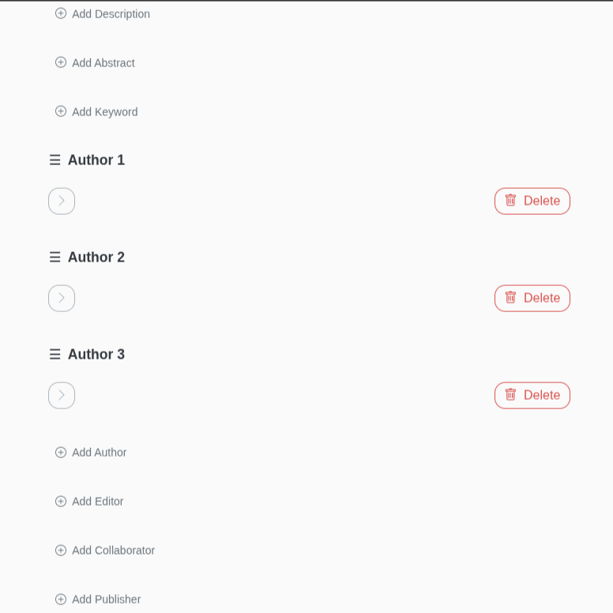

import { Aside, Code, Tabs, TabItem } from '@astrojs/starlight/components';
import ShaclSupport from '../../../components/ShaclSupport.astro';

SHACL (Shapes Constraint Language) shapes describe your data model. HERITRACE reads it for four purposes:

-   **Form generation**: each shape becomes a form, and each property shape becomes a field with its input type and validation hints.
-   **Data validation**: the constraints, such as datatypes and cardinality, are checked on every change.
-   **Presentation**: names, field order, widgets and entity labels come from the [presentation terms](#presentation) of the shapes.
-   **Duplicates**: the [duplicate keys](#duplicate-detection-owlhaskey) of a shape tell HERITRACE which entities may describe the same thing.

## Supported vocabulary

The chips below list the terms that a shapes graph can use in the SHACL 1.2 drafts. HERITRACE reads the highlighted terms and ignores the dimmed ones.

<ShaclSupport />

HERITRACE reads some supported terms only in part. Each item below says which part it reads and which part it ignores.

-   `sh:path` takes a single predicate or an inverse path. SHACL also allows paths that combine several steps, such as a sequence of predicates or a repeated predicate. HERITRACE does not follow those paths.
-   `sh:values` says that the values of a property are computed instead of being stored in the data. SHACL offers several ways to describe the computation: a fixed value, the values found by following a path, or a SPARQL query written with `sh:select`. HERITRACE computes a single case: the entity label, written as a SPARQL query on the property shape that carries `shui:LabelRole`. Any other property shape with `sh:values` is left out of forms.
-   `sh:class` takes a single class. SHACL also accepts a list of classes, meaning that a value may belong to any of them, but HERITRACE does not read that form.
-   `sh:message` is read only next to `sh:pattern`: HERITRACE shows it when a value does not match the pattern of the same shape.
-   `sh:nodeKind` takes `sh:IRI`, `sh:Literal` or `sh:IRIOrLiteral`; `sh:BlankNode` is not supported.
-   `sh:lessThanOrEquals` compares numbers, and dates of the same kind. SHACL also compares texts, which HERITRACE treats as values that cannot be compared.
-   `sh:or` is read in two places. On a property shape, its members can be datatypes, node shapes, fixed values or the member `[ sh:nodeKind sh:IRI ]`. On a node shape, each member must pair a fixed value with a pattern. Members of any other kind are ignored.

## Official documentation

The lists above follow the W3C editor's drafts of the SHACL 1.2 family:

- <a href="https://w3c.github.io/data-shapes/shacl12-core/" target="_blank" rel="noopener noreferrer">SHACL 1.2 Core</a>
- <a href="https://w3c.github.io/data-shapes/shacl12-sparql/" target="_blank" rel="noopener noreferrer">SHACL 1.2 SPARQL-Related Features</a>
- <a href="https://w3c.github.io/data-shapes/shacl12-node-expr/" target="_blank" rel="noopener noreferrer">SHACL 1.2 Node Expressions</a>
- <a href="https://w3c.github.io/data-shapes/shacl12-ui/" target="_blank" rel="noopener noreferrer">SHACL 1.2 User Interfaces</a>

## Where the shapes live

The shapes are part of the HERITRACE configuration, stored in `shacl.ttl` in the configuration folder. They are optional: without shapes, you edit the data with free properties, choosing classes, predicates and values yourself. You can add shapes at any time, starting from an empty configuration. You can edit them in the **Resource types** tab of the [configuration editor](../editor/), or write them in Turtle before the first start.

Example shapes are available in [`example_configurations/`](https://github.com/opencitations/heritrace/tree/main/example_configurations).

## Core concepts

### Namespaces

Define the ontologies and vocabularies you'll use at the top of your Turtle file.

```ttl
@prefix sh: <http://www.w3.org/ns/shacl#> .
@prefix rdf: <http://www.w3.org/1999/02/22-rdf-syntax-ns#> .
@prefix rdfs: <http://www.w3.org/2000/01/rdf-schema#> .
@prefix schema: <http://schema.org/> .
@prefix xsd: <http://www.w3.org/2001/XMLSchema#> .

# Domain-specific vocabularies
@prefix datacite: <http://purl.org/spar/datacite/> .
@prefix dcterms: <http://purl.org/dc/terms/> .
@prefix fabio: <http://purl.org/spar/fabio/> .
@prefix foaf: <http://xmlns.com/foaf/0.1/> .
@prefix pro: <http://purl.org/spar/pro/> .
@prefix prism: <http://prismstandard.org/namespaces/basic/2.0/> .
```

### Shape definition

Each shape targets a specific class and defines its properties.

```ttl
schema:JournalArticleShape
    a sh:NodeShape ;
    sh:targetClass fabio:JournalArticle ;
    sh:property [
        # Property constraints go here
    ] .
```

## Property constraints

SHACL constraints define the validation rules for properties on a targeted class.

### Cardinality (`sh:minCount` and `sh:maxCount`)

Control how many values a property can have. Both count every value of `sh:path` on the
entity, even when the shape declares several property shapes with the same path. For example,
an entity typed both `fabio:Expression` and `fabio:JournalArticle` fails `sh:maxCount 1` on
`rdf:type`, because the count includes both types. To limit how many times one specific value
occurs, see [Occurrences of a specific value](#occurrences-of-a-specific-value-shqualifiedvalueshape).

- `sh:minCount`: The minimum number of values. A value of `1` or more makes the property required.
- `sh:maxCount`: The maximum number of values. A value of `1` restricts it to a single value.

```ttl
# A required, single-value property
sh:property [
    sh:path dcterms:title ;
    sh:minCount 1 ;
    sh:maxCount 1 ;
] .

# An optional, multi-value property
sh:property [
    sh:path prism:keyword ;
    sh:minCount 0 ; # Not required
    # No maxCount means unlimited values
] .
```

### Datatype (`sh:datatype`)

Specify the expected data type for a literal value. You can provide alternatives using `sh:or`.

```ttl
# String value
sh:property [
    sh:path dcterms:title ;
    sh:datatype xsd:string ;
] .

# Date value with multiple allowed formats
sh:property [
    sh:path prism:publicationDate ;
    sh:or (
        [ sh:datatype xsd:date ]        # 2024-01-15
        [ sh:datatype xsd:gYearMonth ]  # 2024-01
        [ sh:datatype xsd:gYear ]       # 2024
    ) ;
] .
```

In the [configuration editor](../editor/), the **Value alternatives** of a field set `sh:or`. Each alternative sets one constraint: a datatype, a SHACL shape, a class or a value, and a SHACL shape can also carry the class it targets. All the alternatives of a field set the same kind of constraint, for example only datatypes or only SHACL shapes, and the editor refuses to save a mix; an **IRI typed in place** can join alternatives of any kind. The alternatives also take the place of the constraints of the field itself: while a field has alternatives, the editor hides its datatype, class, SHACL shape, fixed value, allowed values and values to count. A single alternative is saved as the constraint of the field.

<Aside type="caution" title="Limits of HERITRACE, not of SHACL">
SHACL accepts any shape as an alternative, including alternatives that mix kinds of constraint, lists with a single member and alternatives next to other constraints of the same field ([SHACL, section 4.6.3](https://www.w3.org/TR/shacl/#OrConstraintComponent)). The rules above come from the current implementation of HERITRACE.
</Aside>

### Kind of value (`sh:nodeKind`)

`sh:nodeKind` says whether the values of a property are IRIs (`sh:IRI`), literals (`sh:Literal`) or either (`sh:IRIOrLiteral`).

```ttl
schema:JournalArticleShape
  a sh:NodeShape ;
  sh:targetClass fabio:JournalArticle ;
  sh:property [
    sh:path dcterms:source ;
    sh:nodeKind sh:IRI ;
  ] .
```

In the [configuration editor](../editor/), the **Kind of value** of a field sets this term, and the **IRI typed in place** of a value alternative adds the member to the `sh:or`.

### Numeric bounds (`sh:minInclusive`, `sh:maxInclusive`, `sh:minExclusive` and `sh:maxExclusive`)

Limit a number to a range. With `sh:minInclusive` and `sh:maxInclusive` the range includes the bound value, while with `sh:minExclusive` and `sh:maxExclusive` the range excludes the bound value. HERITRACE compares numbers only: the property needs a numeric datatype, such as `xsd:integer` or `xsd:decimal`, and each bound must be an integer or a decimal. When a whole-number field cannot go below zero, the form also ignores the minus sign as the user types.

```ttl
# A book has at least one page
sh:property [
    sh:path schema:numberOfPages ;
    sh:datatype xsd:integer ;
    sh:minInclusive 1 ;
] .
```

### Values that do not exceed another field (`sh:lessThanOrEquals`)

Use `sh:lessThanOrEquals` to keep each value of a property at or below the values of another property of the same entity, such as a start date that does not follow the end date.

```ttl
schema:EventShape
  a sh:NodeShape ;
  sh:targetClass schema:Event ;
  sh:property [
    sh:path schema:startDate ;
    sh:datatype xsd:date ;
    sh:lessThanOrEquals schema:endDate ;
  ] ;
  sh:property [
    sh:path schema:endDate ;
    sh:datatype xsd:date ;
  ] .
```

HERITRACE compares numbers with numbers and dates with dates of the same kind, such as two years or two full dates. Any other pair cannot be compared and breaks the rule, as in SHACL. The form shows the error under the field that carries the rule, before the save.

In the [configuration editor](../editor/), the **Not greater than** of a field sets this term, with the IRI of the other property.

### Value range (`sh:in` and `sh:hasValue`)

Restrict property values to a specific set of options.

- `sh:hasValue`: The property must have at least one value that equals the specified node.
- `sh:in`: The property value must be one of the members of a provided list.

```ttl
# The value must be exactly pro:author
sh:property [
    sh:path pro:withRole ;
    sh:hasValue pro:author ;
] .

# The value must be one of the specified identifier schemes
sh:property [
    sh:path datacite:usesIdentifierScheme ;
    sh:in ( datacite:doi datacite:pmid datacite:pmcid ) ;
] .
```

HERITRACE renders a property constrained with `sh:hasValue` as a read-only field: the value is
displayed, marked as mandatory, and cannot be edited, added, or removed.

For `sh:in`, forms offer the members of the list in a menu, in their order.

In the [configuration editor](../editor/), the **Fixed value** of a field sets `sh:hasValue`, and its **Allowed values** set `sh:in`.

### Occurrences of a specific value (`sh:qualifiedValueShape`)

Constrain how many values of a property match a given condition, leaving the other values
unconstrained.

- `sh:qualifiedValueShape`: The condition that the counted values must satisfy.
- `sh:qualifiedMinCount` and `sh:qualifiedMaxCount`: How many values may satisfy it.

Give at least one of the two counts, because a condition without them constrains nothing. A missing minimum sets no lower bound, and a missing maximum no upper one. If the minimum is 1 or more, the value becomes mandatory: the data editor fills it in for every resource, and users cannot delete it.

Use this instead of `sh:hasValue` with `sh:minCount`/`sh:maxCount` whenever the property carries
several values at once. A common case is an entity typed with both a general and a specific
class: `sh:maxCount 1` would count both types and could never be satisfied, whereas the
qualified counts apply to each type separately.

```ttl
# The entity must be typed both fabio:Expression and fabio:JournalArticle
sh:property [
    sh:path rdf:type ;
    sh:qualifiedValueShape [ sh:hasValue fabio:Expression ] ;
    sh:qualifiedMinCount 1 ;
    sh:qualifiedMaxCount 1 ;
] ;
sh:property [
    sh:path rdf:type ;
    sh:qualifiedValueShape [ sh:hasValue fabio:JournalArticle ] ;
    sh:qualifiedMinCount 1 ;
    sh:qualifiedMaxCount 1 ;
] .
```

A condition can also count several values together, through an `sh:or` of `sh:hasValue`, and the counts then apply to their total.

```ttl
# The entity can be typed at most once as fabio:Book or fabio:Thesis
sh:property [
    sh:path rdf:type ;
    sh:qualifiedValueShape [
        sh:or ( [ sh:hasValue fabio:Book ] [ sh:hasValue fabio:Thesis ] )
    ] ;
    sh:qualifiedMaxCount 1 ;
] .
```

In the configuration editor, **Values to count** holds the condition, whose **Values** are the IRIs to count, while **Minimum occurrences** and **Maximum occurrences** set the counts. Two or more values become an `sh:or` when saved. The editor rejects a condition without either count.

### Shape reference (`sh:node`)

Specify that a property's value must conform to another shape. This is used to validate complex objects or relationships.

```ttl
# The value for 'hasIdentifier' must be an entity that validates
# against the 'JournalArticleIdentifierShape'.
sh:property [
    sh:path datacite:hasIdentifier ;
    sh:node schema:JournalArticleIdentifierShape ;
] .
```

<Aside type="caution" title="Avoid recursive shapes">
A shape is recursive when following `sh:node` leads back to it, for example when an article lists its citations and each citation points back to the article through `sh:node`. To avoid infinite loops, HERITRACE stops nesting at the first repeated shape, but nested forms can still slow down the start of the application. To break a loop, declare the link with `sh:class` and `shui:AutoCompleteEditor`, without `sh:node`.
</Aside>

### Inverse paths (`sh:inversePath`)

A field normally shows the triples that start from the current entity. Sometimes the triples to show end at the current entity instead. `sh:inversePath` reads them backwards: the field shows the entities they start from.

For example, a citation can be stored as a separate entity that states which article cites and which one is cited:

```ttl
:citation1 a cito:Citation ;
    cito:hasCitingEntity :article1 ;
    cito:hasCitedEntity :article2 .
```

Here the triple starts from the citation and ends at `:article1`. To list the citations of an article, add a field with an inverse path to the shape of the article:

```ttl
sh:property [
    sh:path [ sh:inversePath cito:hasCitingEntity ] ;
    sh:name "Citations" ;
    sh:node schema:CitationShape ;
] .
```

When a user adds a citation from this field, the form does not ask for the citing article, because it is the article being edited. HERITRACE writes that triple on saving.

In the [configuration editor](../editor/), the **Property** of a field offers two choices. **IRI** takes the property itself; **Inverse path** asks for the property whose triples the field reads backwards.

### Pattern matching (`sh:pattern` and `sh:message`)

Use `sh:pattern` to check the format of a value with a regular expression, and `sh:message` to tell users what went wrong. On a property shape, the pattern checks every value of the field.

```ttl
schema:JournalShape
  a sh:NodeShape ;
  sh:targetClass fabio:Journal ;
  sh:property [
    sh:path prism:issn ;
    sh:datatype xsd:string ;
    sh:pattern "^\\d{4}-\\d{3}[\\dX]$" ;
    sh:message "Enter an ISSN, such as 0138-9130." ;
  ] .
```

A value matches when the expression finds a match anywhere in it. Start the expression with `^` and end it with `$` to check the whole value. Without `sh:message`, the form shows the pattern it expects.

A pattern can also depend on another field of the same entity. Put it in an alternative of the node shape's `sh:or`, next to the fixed value that makes it apply:

```ttl
schema:JournalArticleIdentifierShape
  a sh:NodeShape ;
  sh:targetClass datacite:Identifier ;
  sh:property [
    sh:path datacite:usesIdentifierScheme ;
    sh:in ( datacite:doi datacite:pmid ) ;
  ] ;
  sh:property [
    sh:path literal:hasLiteralValue ;
    sh:datatype xsd:string ;
  ] ;
  sh:or (
    [
      sh:property [
        sh:path datacite:usesIdentifierScheme ;
        sh:hasValue datacite:doi ;
      ] ;
      sh:property [
        sh:path literal:hasLiteralValue ;
        sh:pattern "^10\\..+/.+" ;
        sh:message "DOI must start with '10.'." ;
      ] ;
    ]
    [
      sh:property [
        sh:path datacite:usesIdentifierScheme ;
        sh:hasValue datacite:pmid ;
      ] ;
      sh:property [
        sh:path literal:hasLiteralValue ;
        sh:pattern "^[1-9]\\d*$" ;
        sh:message "PMID must contain only numbers." ;
      ] ;
    ]
  ) .
```

A value needs to match one of the patterns whose condition holds, as well as the patterns of its own field.

In the [configuration editor](../editor/), the **Pattern** and **Pattern message** of a field set its own pattern. The **Format rules** of a resource type set the `sh:or`: each rule names a **Condition field** and a **Condition value**, then the **Checked field** and the **Pattern** its value must match, with an optional **Message** in each language.

### Values that depend on their entity (`dash:composite`)

Add `dash:composite true` to a property shape when its values have a meaning only in relation to the entity that holds them. When such a value is removed, or the entity that holds it is deleted, the value becomes useless. The **Dependent resources** option in the [system settings](../editor/) chooses what HERITRACE does with it: delete it, ask each time, or keep it. A value that another entity also reaches through the same property stays in any case.

Without `dash:composite`, removing a value removes only the link, and the linked entity stays.

The **Points to a dependent resource** option of the [configuration editor](../editor/) sets this term on a field that links to another resource, through a **SHACL shape of the value** (`sh:node`), a **Class of the value** (`sh:class`) or **Value alternatives** (`sh:or`).

<Aside type="note" title="A HERITRACE rule, not a DASH one">
Although DASH declares `dash:composite` on any property shape, it does not require the values to be nodes or entities ([DASH, section "Composites"](https://datashapes.org/dash.html#composites)). However, the term has no meaning on a property that does not point to another entity. HERITRACE therefore adds the following restriction to the shapes of its configuration editor:

```ttl
sh:or (
    [ sh:path dash:composite ; sh:in ( false ) ]
    [ sh:path sh:node ; sh:minCount 1 ]
    [ sh:path sh:class ; sh:minCount 1 ]
    [ sh:path sh:or ; sh:minCount 1 ]
) .
```
</Aside>

The term comes from [DASH](https://datashapes.org/dash.html#composites).

## Presentation

HERITRACE takes from the shapes graph the names of entity types and fields, their order, the widget of each field and the label of each entity. Declare the `shui:` prefix to use the SHACL UI terms, and the `dash:` prefix for `dash:hidden`, which comes from [DASH](https://datashapes.org/dash.ttl) because SHACL UI has no equivalent term:

```ttl
@prefix shui: <http://www.w3.org/ns/shacl-ui/> .
@prefix dash: <http://datashapes.org/dash#> .
```

### Names (`sh:name`)

On a node shape, `sh:name` names the kind of entity that the shape describes, so `schema:JournalArticleShape` appears as "Journal Article".
On the other hand, `sh:name` on a property shape names the property, so `dcterms:title` appears as "Title".

```ttl
schema:JournalArticleShape
    a sh:NodeShape ;
    sh:targetClass fabio:JournalArticle ;
    sh:name "Journal Article" ;
    sh:property [
        sh:path dcterms:title ;
        sh:name "Title" ;
    ] .
```

Several property shapes can share a path and differ by `sh:node`. Each one keeps its own name. Here the roles of an article appear as "Author" and "Editor":

```ttl
sh:property [
    sh:path pro:isDocumentContextFor ;
    sh:node schema:AuthorShape ;
    sh:name "Author" ;
] ;
sh:property [
    sh:path pro:isDocumentContextFor ;
    sh:node schema:EditorShape ;
    sh:name "Editor" ;
] .
```

Without `sh:name`, HERITRACE derives a readable name from the IRI, so `hasPublicationDate` becomes "Has publication date" and `anyURI` becomes "Any URI".

### Descriptions (`sh:description`)

A property shape can carry a `sh:description` that explains its field. HERITRACE shows it in smaller text under the field, both on the entity page and in the form.

```ttl
sh:property [
    sh:path dcterms:title ;
    sh:name "Title" ;
    sh:description "A name given to the resource." ;
] .
```

### Languages

HERITRACE speaks English and Italian, and users choose between them in the account menu. When you tag `sh:name`, `sh:description` and the messages of `sh:message` with a language, they follow that choice:

```ttl
sh:property [
    sh:path dcterms:title ;
    sh:name "Title"@en, "Titolo"@it ;
    sh:description "A name given to the resource."@en,
        "Un nome dato alla risorsa."@it ;
] .
```

HERITRACE shows each text in the language of the interface. When a shape gives no text in that language, it uses the text without a language tag, which stands for every language; only when that is missing too does it show a text in another language.

### Order (`sh:order`)

Fields follow the ascending value of `sh:order`. Property shapes without `sh:order` come after the ordered ones, sorted alphabetically by `sh:name`, or by the IRI of their path when they have no name. Without any `sh:order`, all fields follow this alphabetical order. The same rule sorts two shapes that share a position.

If you are wondering why HERITRACE does not simply keep the order in which you wrote the properties: SHACL is a graph after all, and a graph does not remember which triple came first.

```ttl
sh:property [ sh:path dcterms:title ; sh:name "Title" ; sh:order 1 ] ;
sh:property [ sh:path prism:publicationDate ; sh:name "Publication Date" ; sh:order 2 ] .
```

In the [configuration editor](../editor/), you set this order by dragging the fields of an entity type. HERITRACE then numbers every field from 1 onward, including those that had no `sh:order`.

### Sections (`sh:group`)

A property shape can name a `sh:PropertyGroup` with `sh:group`. Forms and resource pages show the fields of each group together, under the `rdfs:label` of the group, which follows the language of the interface like `sh:name`.

```ttl
ex:PublicationGroup a sh:PropertyGroup ;
    rdfs:label "Publication"@en, "Pubblicazione"@it ;
    sh:order 1 .

sh:property [
    sh:path prism:publicationDate ;
    sh:name "Publication Date" ;
    sh:group ex:PublicationGroup ;
] .
```

In the [configuration editor](../editor/), the **Resource types** tab lists the sections under **Sections**, and each field picks its own under **Section**.

### Widgets (`shui:editor`)

HERITRACE picks the input of each property with the scoring system of SHACL 1.2 User Interfaces. Every editor that fits the property shape earns a score from its constraints, and the highest score wins; when two editors tie, the one with the alphabetically first IRI wins. The scores are built into HERITRACE and follow the `shui:WidgetScore` and `shui:WidgetAcceptMatcher` rules published with the draft.

| Constraint of the property | Editor | Score |
| --- | --- | --- |
| `shui:editor` | The declared editor | 40 |
| `sh:in`, or alternatives with `sh:hasValue` | `shui:EnumSelectEditor`: a menu of values, which becomes a sheet with a search field above ten values | 30 |
| `xsd:string` | `shui:TextFieldEditor` | 10 |
| `rdf:langString` | `shui:TextFieldWithLangEditor` | 10 |
| `xsd:boolean` | `shui:BooleanEditor`, a switch | 10 |
| `xsd:date`, `xsd:gYearMonth` or `xsd:gYear` | `shui:DatePickerEditor`, a calendar; when the shape allows more than one of these datatypes, users also choose between a full date, a month and a year | 10 |
| A numeric datatype | `shui:NumberFieldEditor` | 10 |
| `sh:class` with `sh:nodeKind sh:IRI` | `shui:AutoCompleteEditor` | 10 |
| `sh:nodeKind sh:IRI` without `sh:class` | `shui:IRIEditor` | 10 |
| `sh:node` | A row that opens the fields of the resource in a separate window | 10 |
| None of the above | `shui:TextFieldEditor` | 1 |

Whatever editor wins, numbers and `xsd:anyURI` open the matching keyboard.

:::caution[Rules beyond the draft]

Some scores belong to HERITRACE alone, and another implementation of SHACL 1.2 User Interfaces may pick a different editor for the same property.

- SHACL 1.2 User Interfaces does not support partial dates (yet). When `xsd:gYearMonth` or `xsd:gYear` is among the datatypes, also inside `sh:or`, HERITRACE gives 10 points to `shui:DatePickerEditor`, which the draft defines for `xsd:date` alone.
- Alternatives with `sh:hasValue` earn 30 points for `shui:EnumSelectEditor`, while the draft counts only `sh:in`.
- A property with `sh:node` points to a resource that has fields of its own. The draft gives it an editor only when the property declares `shui:DetailsEditor`, which shows those fields inside the form. Without that declaration, HERITRACE shows the resource as a row that opens its fields in a separate window, at 10 points.
- A declared `shui:AutoCompleteEditor` earns 40 points with `sh:node` alone, where the draft also asks for `sh:class`.
- Each alternative of `sh:or` takes the `shui:editor` of its property.
- A property that matches no rule gets `shui:TextFieldEditor` at 1 point; the draft leaves it without an editor.

:::

The datatype cannot tell a short title from a long abstract, though, because both are strings. For such fields, `shui:editor` sets the input: `shui:TextAreaEditor` asks for a multi-line text area, and `shui:TextFieldEditor` for a single-line field.

```ttl
sh:property [
    sh:path dcterms:abstract ;
    sh:datatype xsd:string ;
    shui:editor shui:TextAreaEditor ;
] .
```

A text can also come in several languages. `shui:TextFieldWithLangEditor` and `shui:TextAreaWithLangEditor` give each value a single-line or multi-line input, next to a menu that sets its language: one of the two-letter ISO 639-1 codes, or none. The property accepts tagged values when `rdf:langString` is among its datatypes, or when it declares no datatype. Add `sh:uniqueLang` to refuse two values in the same language:

```ttl
sh:property [
    sh:path dcterms:abstract ;
    sh:datatype rdf:langString ;
    sh:uniqueLang true ;
    shui:editor shui:TextAreaWithLangEditor ;
] .
```

A link to another entity can reuse the entities that already exist. Give the property shape `shui:AutoCompleteEditor` and declare the class of the linked entity with `sh:class`. The form shows a search field and offers to create a new entity through the `sh:node` shape. Without `sh:node`, the form shows only the search field. When the property has alternatives in `sh:or`, the user first picks the type, so each alternative declares its own `sh:class` and the editor stays on the property. A property with `sh:class` and `sh:nodeKind sh:IRI` gets this editor without declaring it.

```ttl
sh:property [
    sh:path frbr:partOf ;
    sh:class fabio:Journal ;
    sh:node schema:JournalShape ;
    shui:editor shui:AutoCompleteEditor ;
] .
```

The search looks in the text fields of the linked shape and of the shapes nested directly inside it, so a person can be found by name or by ORCID. Without `sh:node`, the linked shape is the one whose `sh:targetClass` is the declared class.

### Nested entities in place (`shui:DetailsEditor`, `shui:DetailsViewer`)

By default, HERITRACE shows a linked entity as a link. On the entity page, the link shows its label. In the form, the linked entity opens in a dialog of its own.

`shui:DetailsEditor` shows the fields of the linked entity inside the form, next to the fields of the entity being edited. `shui:DetailsViewer` does the same on the entity page, where the fields of the linked entity take the place of the link. These widgets suit entities that act as proxies, such as blank nodes or entities that only bridge two others and add properties to the link between them.

While you edit the entity page, the values that `shui:DetailsViewer` shows in place become inputs, and saving updates the linked entity directly.

The fields come from the `sh:node` shape. To show only some of them, list them with `sh:property` on the property shape: HERITRACE takes their definition from the `sh:node` shape, and the other fields keep their values and constraints. Here an author role shows only the person who holds it:

```ttl
sh:property [
    sh:path pro:isDocumentContextFor ;
    sh:node schema:AuthorShape ;
    shui:editor shui:DetailsEditor ;
    shui:viewer shui:DetailsViewer ;
    sh:property [ sh:path pro:isHeldBy ] ;
] .
```

### Hidden fields and entity types (`dash:hidden`)

On a property shape, `dash:hidden true` removes the field from forms and entity pages. On a node shape, it removes the entity type from the catalogue, from the recycle bin and from the types that users can create, although its entities stay reachable from other entities. HERITRACE validates hidden fields and entity types like any other.

```ttl
schema:IdentifierShape
    a sh:NodeShape ;
    sh:targetClass datacite:Identifier ;
    dash:hidden true .
```

The **Hidden** option of the [configuration editor](../editor/) sets this term on both fields and resource types.

<Aside type="note" title="dash:hidden on node shapes">
Although DASH declares `sh:PropertyShape` as the domain of `dash:hidden`, TopQuadrant, which maintains DASH, [applies the term to classes as well](https://github.com/TopQuadrant/shacl/blob/master/src/main/resources/rdf/tosh.ttl). Since HERITRACE applies no RDFS inference to the shapes graph, the declared domain causes no problem here, and HERITRACE follows the same practice.
</Aside>

### Order of values (`ht:orderedBy`)

Some properties hold values whose order matters, such as the authors of an article. SHACL UI leaves this order open: "The order of the values within a single shape is left to the implementation" ([SHACL 1.2 User Interfaces](https://w3c.github.io/data-shapes/shacl12-ui/#property-roles)). Neither SHACL nor DASH has a term that names the property linking each value to the next one, so HERITRACE defines `ht:orderedBy` in its own namespace:

```ttl
@prefix ht: <https://w3id.org/heritrace#> .
```

On a property shape, `ht:orderedBy` names the property that links each value to the next one. HERITRACE shows the values in the order of that chain, and users can drag them into a new order. Here the authors of an article follow `oco:hasNext`:

```ttl
sh:property [
    sh:path pro:isDocumentContextFor ;
    sh:node schema:AuthorShape ;
    ht:orderedBy oco:hasNext ;
] .
```



When users save a new order, HERITRACE rewrites the chain. The first value has no predecessor, and the last value has no next value:

```ttl
@prefix ex: <http://example.org/ontology/> .
@prefix : <http://example.org/instance/> .

# The order of the values in this triple carries no meaning.
:myResource ex:hasItem :item1, :item2, :item3 .

# ex:hasNext, named by ht:orderedBy, links each item to the next one.
:item1 ex:hasNext :item2 .
:item2 ex:hasNext :item3 .
```

The **Link to the next value** option of the [configuration editor](../editor/) sets this term on a field.

### Labels (`shui:LabelRole` and `rdfs:label`)

Each entity is identified by an IRI, such as `https://w3id.org/oc/meta/ra/0601`, which people cannot read. Its label is the text that HERITRACE shows in place of the IRI, such as "Maltezou, Helen C.". HERITRACE follows the label resolution of SHACL UI and stops at the first of these sources that gives a result:

1. The property shape that the node shape of the entity marks with `shui:propertyRole shui:LabelRole`.
2. The `rdfs:label` of the IRI in the data, in the language of the interface.
3. The `rdfs:label` of the IRI in the shapes graph, in the same language.
4. The local name of the IRI, made readable as for property names, so `https://w3id.org/oc/meta/ra/0601` becomes "0601".

The same order names every IRI that appears as a value, including those that no node shape describes, such as the members of an `sh:in` list, the value of `sh:hasValue` or a datatype. Because such terms usually come from a vocabulary outside the dataset, the shapes graph is where to name them. An `rdfs:comment` beside the label explains the term, and menus show it under the name of each option.

If the data already holds a readable name, give the role to the property shape of that name. Here an agent is labelled by its `foaf:name`:

```ttl
schema:ResponsibleAgentShape
    sh:property [
        sh:path foaf:name ;
        sh:datatype xsd:string ;
        sh:name "Name" ;
        shui:propertyRole shui:LabelRole ;
    ] .
```

If no single value is enough, build the label with `sh:values` and a SPARQL query written with `sh:select`. The query returns exactly one variable, and `$this` stands for the entity being labelled. Here a volume is labelled with its number and the title of its journal:

```ttl
schema:JournalVolumeShape
    sh:property [
        sh:path rdfs:label ;
        shui:propertyRole shui:LabelRole ;
        sh:values [
            sh:select """
                SELECT ?display
                WHERE {
                  $this fabio:hasSequenceIdentifier ?number ;
                        frbr:partOf ?journal .
                  ?journal dcterms:title ?journalTitle .
                  BIND(CONCAT("Vol. ", ?number, ", ", ?journalTitle) AS ?display)
                }
            """ ;
        ] ;
    ] .
```

The prefixes that the query uses are declared once for the whole shapes graph:

```ttl
[] a sh:ShapesGraph ;
    sh:declare
        [ sh:prefix "dcterms" ; sh:namespace "http://purl.org/dc/terms/"^^xsd:anyURI ] ,
        [ sh:prefix "fabio" ; sh:namespace "http://purl.org/spar/fabio/"^^xsd:anyURI ] ,
        [ sh:prefix "frbr" ; sh:namespace "http://purl.org/vocab/frbr/core#"^^xsd:anyURI ] .
```

If a label query returns no result, HERITRACE moves on to the next source.

A label query can also read the language of the interface from `$language`, which holds `"en"` or `"it"`. Use it to prefer the text in that language, as in `FILTER(LANG(?title) = $language)`.

HERITRACE checks every label query before it accepts the shapes, whether they come from the editor or from `shacl.ttl`: the query has to be valid SPARQL that uses only declared prefixes and returns a single variable.

<Aside type="caution" title="Labels that follow incoming references">
A label query can use `$this` as an object and build the label from the entities that point at it. HERITRACE detects this and loads those entities on history pages, which is expensive when an entity has many referrers. Such a label also resolves only for snapshots taken after the referring entity existed, so prefer following references away from the entity.
</Aside>

<Aside type="caution" title="$language is a HERITRACE extension">
`$language` works only in HERITRACE: it is not part of <a href="https://w3c.github.io/data-shapes/shacl12-sparql/#SelectExpression" target="_blank" rel="noopener noreferrer">SHACL 1.2 SPARQL-Related Features</a>.
</Aside>

<Aside type="caution" title="The label query in the configuration editor">
SHACL attaches the label query to a property shape, while the [configuration editor](../editor/) shows it on the resource type. This simplification follows from HERITRACE computing `sh:values` only for the label. Nonetheless, saving writes the standard form shown above.
</Aside>

## Duplicate detection (`owl:hasKey`)

Each `owl:hasKey` on a node shape is a list of properties. Two entities of the shape match a key when, for every property in the list, they share at least one value. A shape can carry several keys, and matching any one of them is enough.

HERITRACE uses the keys in two places. While an entity is being created, a warning links to the existing entities that match it; for a nested field, HERITRACE compares the text values of the nested entity. On an entity page, the matches appear in the [Similar resources](/heritrace/user-guide/merging-records/) section, where users can merge them.

```ttl
schema:ResponsibleAgentShape
    a sh:NodeShape ;
    sh:targetClass foaf:Agent ;
    owl:hasKey
        ( foaf:name ) ,
        ( foaf:familyName foaf:givenName ) ,
        ( datacite:hasIdentifier ) .
```

With these keys, two agents match when they have the same full name, when they have both the same family name and the same given name, or when they share an identifier.

HERITRACE reads `owl:hasKey` on the node shape rather than on its target class, so each shape of a class can carry its own keys. It does not infer `owl:sameAs` from a match: it proposes the two entities for a merge, and the user decides.

In the [configuration editor](../editor/), the **Criteria for finding duplicates** of a resource type set `owl:hasKey`, one criterion for each key.
